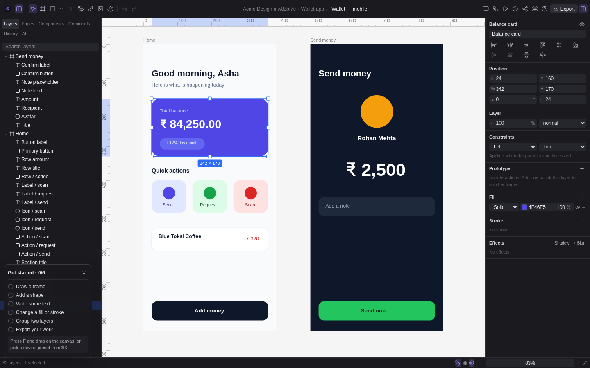
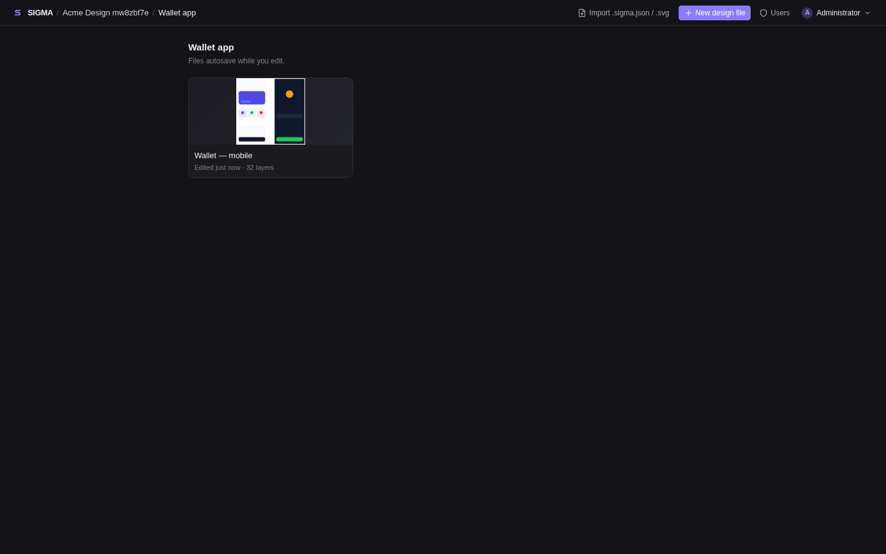
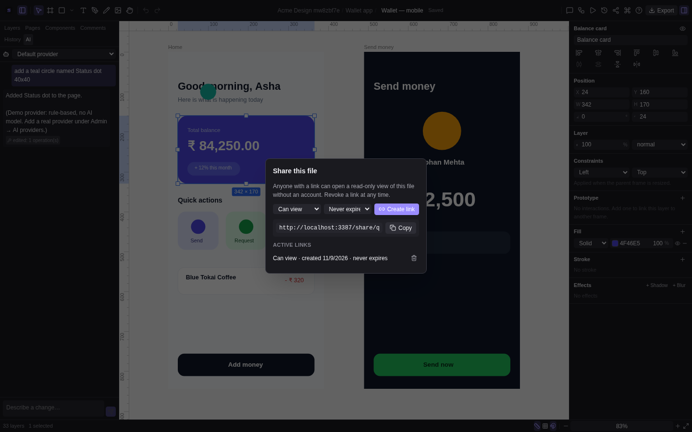
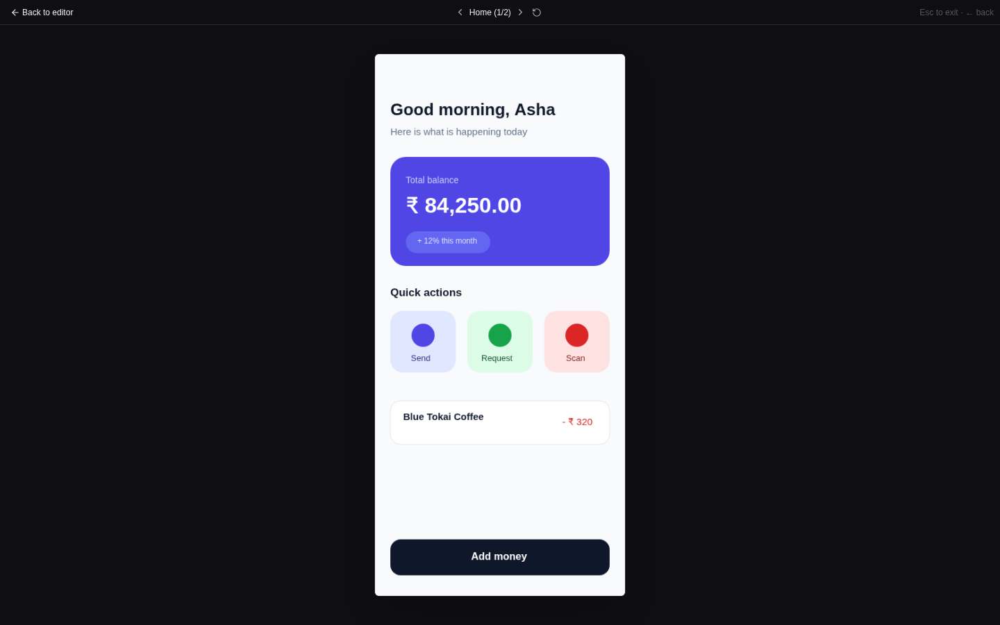
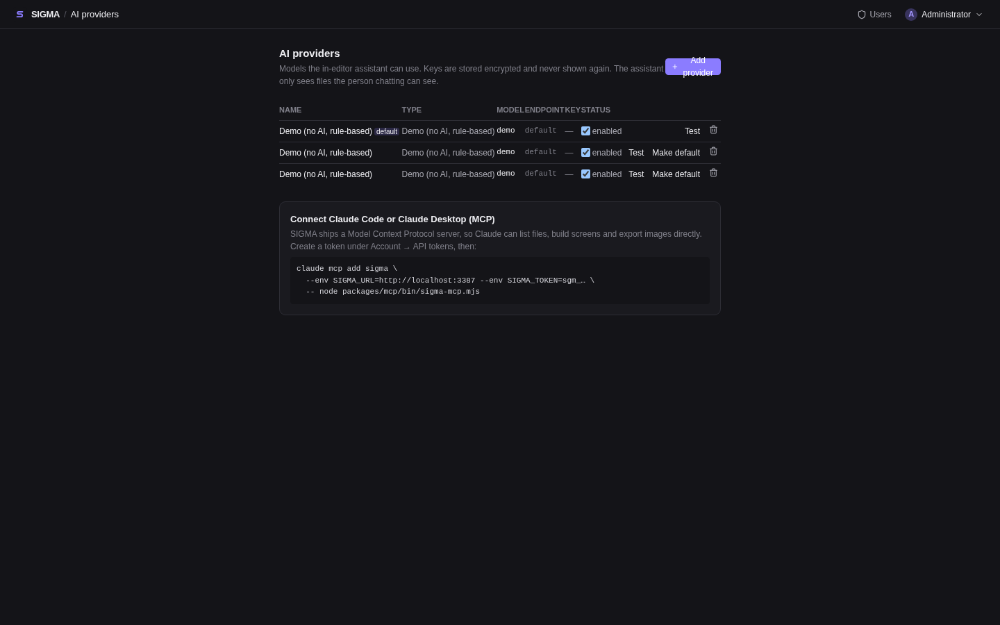

<div align="center">


# SIGMA

**A self-hosted, collaborative design platform with its own canvas engine.**

Design screens, build components, prototype flows, hand off to developers, and let an AI
assistant or Claude build alongside you. Everything runs on your own machine or server with one
command.

[](https://github.com/atreyakamat/sigma/actions/workflows/ci.yml)
[](https://github.com/atreyakamat/sigma/releases)
[](LICENSE)



</div>

## Contents

- [Easiest install](#easiest-install-no-technical-setup)
- [Quick start from source](#quick-start-from-source-5-minutes)
- [What you can do](#what-you-can-do)
- [A short tour](#a-short-tour)
- [AI: assistant, providers and Claude](#ai-assistant-providers-and-claude)
- [Everyday guides](#everyday-guides)
- [Configuration](#configuration)
- [For developers](#for-developers)
- [Documentation](#documentation)
- [Troubleshooting](#troubleshooting)
- [License](#license)

## Easiest install (no technical setup)

Install [Docker Desktop](https://www.docker.com/products/docker-desktop/), open it, then paste
one line.

**Mac or Linux** (Terminal):

```bash
curl -fsSL https://raw.githubusercontent.com/atreyakamat/sigma/main/install/install.sh | sh
```

**Windows** (PowerShell):

```powershell
irm https://raw.githubusercontent.com/atreyakamat/sigma/main/install/install.ps1 | iex
```

The installer downloads ready-made images, creates secure settings, starts SIGMA, opens it in
your browser and shows your sign-in details (also saved in `~/sigma/SIGMA-LOGIN.txt`). It leaves
`start-sigma`, `stop-sigma`, `update-sigma` and `backup-sigma` launchers you can double-click.
Step-by-step help: [install/README.md](install/README.md).

## Quick start from source (5 minutes)

You need [Docker](https://docs.docker.com/get-docker/) with the Compose plugin. Nothing else.

```bash
git clone https://github.com/atreyakamat/sigma.git
cd sigma
cp .env.docker.example .env.docker
docker compose --env-file .env.docker up -d --build
```

Then:

1. Open **http://localhost:3387**.
2. Get the first administrator password:
   ```bash
   docker compose logs api | grep -A3 'first start'
   ```
3. Sign in as `admin@sigma.local`, choose your own password, and you are in.
4. Create a workspace, a project and a design file. Press `R` and drag to draw your first shape.

> Before sharing the instance with other people, edit `.env.docker` and change `SESSION_SECRET`
> and `POSTGRES_PASSWORD`. To use another port, change `WEB_PORT` and `PUBLIC_URL` together.

To stop: `docker compose --env-file .env.docker down`. Your data stays in Docker volumes.

## What you can do

| Area                | Highlights                                                                                                                                                                    |
| ------------------- | ----------------------------------------------------------------------------------------------------------------------------------------------------------------------------- |
| **Design**          | Infinite canvas, frames, shapes, text, images, pen and pencil, vector editing, boolean operations, gradients, shadows, blur, snapping, rulers, alignment, layers panel, pages |
| **Design systems**  | Components, variants, instances with overrides, auto layout, constraints, shared workspace libraries, design tokens                                                           |
| **Collaborate**     | Real-time co-editing, live cursors and selections, comments pinned to layers, frame review states and locks, version history with visual diff and restore                     |
| **Prototype**       | Click, hover, drag, delay and key interactions, transitions, overlays, a preview player                                                                                       |
| **Hand off**        | PNG, SVG and PDF export, server-rendered image URLs, tokens as JSON or CSS, API tokens, a command-line tool                                                                   |
| **Share**           | Read-only links that open without an account, with expiry and one-click revocation                                                                                            |
| **AI**              | An in-editor assistant that edits the file for you, pluggable providers (Claude, OpenAI, local models), and an MCP server so Claude can build designs directly                |
| **Run it yourself** | One Docker Compose stack, admin-managed accounts, roles (owner, admin, editor, viewer), two-factor sign-in, audit log, HTTPS profile, backups                                 |

## A short tour

**Projects and files.** Workspaces hold projects; projects hold design files with live thumbnails.



**The editor.** Tools on top, layers on the left, properties on the right. `Ctrl/⌘ K` opens the
command palette, `?` lists every shortcut, and a short checklist walks new users through the
basics.

**The assistant.** Open the **AI** tab and describe a change. The assistant reads the file, edits
it, and everyone in the file sees the result.


**Sharing.** Create a view-only link for people without an account, and revoke it at any time.



**Prototype preview.** Press Play to click through your screens.



## AI: assistant, providers and Claude

SIGMA has three ways to bring a model into your design work. All of them use the same validated
editing operations, respect the user's role, and save normal revisions you can roll back.

### 1. The in-editor assistant

Open a file, choose the **AI** tab in the left sidebar, and type what you want:

- "Add a blue rectangle named Hero 320x200"
- "Create a login screen with an email field, a password field and a primary button"
- "Rename Hero to Banner" or "List layers"

Viewers get a read-only assistant that can describe the file but not change it.

### 2. Choose your AI provider

An administrator connects providers under **account menu → AI providers**.



| Provider               | What to enter                              | Notes                                                                                                                              |
| ---------------------- | ------------------------------------------ | ---------------------------------------------------------------------------------------------------------------------------------- |
| **Anthropic (Claude)** | API key, model (default `claude-opus-5-5`) | Uses the official Anthropic SDK                                                                                                    |
| **OpenAI**             | API key, model                             | Chat Completions with tool calling                                                                                                 |
| **OpenAI-compatible**  | Base URL, model, optional key              | Ollama (`http://host.docker.internal:11434/v1`), LM Studio, vLLM, OpenRouter, Groq and others. The model must support tool calling |
| **Demo**               | Nothing                                    | Rule-based, no AI. Good for trying the assistant without an account                                                                |

Keys are stored encrypted and never shown again. Use **Test** to check a provider end to end. To
keep designs on your own network, use a local OpenAI-compatible endpoint.

### 3. Connect Claude (MCP server and skill)

SIGMA ships a [Model Context Protocol](https://modelcontextprotocol.io) server, so Claude Code,
Claude Desktop and other MCP clients can list files, build screens, render images and create
share links.

```bash
pnpm install                      # once, on the machine where Claude runs
# In SIGMA: account menu → API tokens → New token
claude mcp add sigma \
  --env SIGMA_URL=http://localhost:3387 --env SIGMA_TOKEN=sgm_your_token \
  -- node packages/mcp/bin/sigma-mcp.mjs
```

Then ask Claude: _"Create a file in SIGMA called Onboarding and design a three-screen sign-up
flow."_ It will tell you the file URL so you can watch the screens appear.

A ready-made **Claude skill** (`integrations/claude/skills/sigma-design`) teaches Claude the
workflow and design conventions. Setup for Claude Desktop and other clients is in
[`integrations/claude/README.md`](integrations/claude/README.md).

| Tool                                                                   | What it does                             |
| ---------------------------------------------------------------------- | ---------------------------------------- |
| `sigma_list_workspaces`, `sigma_list_projects`, `sigma_list_documents` | Find your work                           |
| `sigma_create_project`, `sigma_create_document`                        | Start new work                           |
| `sigma_get_outline`                                                    | Read a file's layers, positions and text |
| `sigma_apply_ops`                                                      | Add, update, move and delete layers      |
| `sigma_export_png`, `sigma_export_svg`                                 | See and export the result                |
| `sigma_design_tokens`, `sigma_list_frames`                             | Developer handoff                        |
| `sigma_save_version`, `sigma_create_share_link`                        | Checkpoint and share                     |

## Everyday guides

<details>
<summary><b>Invite your team</b></summary>

Accounts are created by an administrator; there is no public sign-up.

1. Account menu → **Users** → **New user**. SIGMA generates a temporary password.
2. Give the person their email and temporary password. They choose their own on first sign-in.
3. Open a workspace → **Members** → add them as viewer, editor or admin.

</details>

<details>
<summary><b>Work together in real time</b></summary>

Open the same file in two browsers. You see each other's cursors and selections, and edits appear
as they happen. Press `C` to drop a comment on a layer. Mark frames as Draft, In review or
Approved from the inspector, and lock a frame while you work on it.

</details>

<details>
<summary><b>Go back in time</b></summary>

Toolbar → **Version history**. Name a checkpoint, compare any version with the current file, and
restore it. SIGMA also keeps automatic hourly snapshots and takes a safety checkpoint before every
restore.

</details>

<details>
<summary><b>Export and hand off</b></summary>

- **Export** in the toolbar downloads PNG, SVG, PDF or the `.sigma.json` file.
- Developers can fetch images and tokens with an API token:
  ```bash
  export SIGMA_URL=http://localhost:3387 SIGMA_TOKEN=sgm_your_token
  node packages/cli/bin/sigma.mjs frames <documentId> --approved
  node packages/cli/bin/sigma.mjs export-all <documentId> ./out --format png --scale 2
  node packages/cli/bin/sigma.mjs export <documentId> deck.pdf --approved
  node packages/cli/bin/sigma.mjs tokens <documentId> --css > tokens.css
  ```

</details>

<details>
<summary><b>Turn on two-factor sign-in</b></summary>

Account menu → **Security** → **Enable**. Scan the QR code with any authenticator app, enter the
code, and store the recovery codes. The same page lists your sessions and lets you sign out other
devices.

</details>

<details>
<summary><b>Put it on the internet with HTTPS</b></summary>

Point a DNS name at the server, then set in `.env.docker`:

```
PUBLIC_HOST=design.example.com
PUBLIC_URL=https://design.example.com
COOKIE_SECURE=true
```

Start with `docker compose --env-file .env.docker --profile https up -d --build`. Certificates are
obtained and renewed automatically.

</details>

<details>
<summary><b>Back up and restore</b></summary>

```bash
scripts/backup.sh                          # database + uploaded images → ./backups/sigma-<time>/
scripts/restore.sh backups/sigma-<time>
```

</details>

<details>
<summary><b>Upgrade</b></summary>

```bash
scripts/backup.sh
git pull
docker compose --env-file .env.docker up -d --build
```

Database migrations run automatically when the API starts.

</details>

<details>
<summary><b>Keyboard shortcuts</b></summary>

`V` select · `F` frame · `R` rectangle · `O` ellipse · `L` line · `T` text · `P` pen · `H` hand ·
`Space` pan · `Ctrl/⌘ + scroll` zoom · `Ctrl/⌘ Z` undo · `Shift Ctrl/⌘ Z` redo · `Ctrl/⌘ D`
duplicate · `Ctrl/⌘ G` group · `Ctrl/⌘ K` command palette · `C` comment · `Shift A` auto layout ·
`Ctrl/⌘ 1` zoom to fit · `?` all shortcuts

</details>

## Configuration

Everything is set in `.env.docker` (copied from `.env.docker.example`).

| Variable                   | Default                 | Meaning                                                                             |
| -------------------------- | ----------------------- | ----------------------------------------------------------------------------------- |
| `WEB_PORT`                 | `3387`                  | Port the UI is served on                                                            |
| `PUBLIC_URL`               | `http://localhost:3387` | Address users type in the browser; used for share links                             |
| `SESSION_SECRET`           | placeholder             | Signs sessions and encrypts stored secrets. **Change it**                           |
| `POSTGRES_PASSWORD`        | `sigma`                 | Database password. **Change it**                                                    |
| `BOOTSTRAP_ADMIN_EMAIL`    | `admin@sigma.local`     | First administrator                                                                 |
| `BOOTSTRAP_ADMIN_PASSWORD` | empty                   | Leave empty to have one generated and printed in the API log                        |
| `COOKIE_SECURE`            | `false`                 | Set `true` when served over HTTPS                                                   |
| `PUBLIC_HOST`              | `localhost`             | DNS name for the HTTPS profile                                                      |
| `MAX_UPLOAD_MB`            | `20`                    | Largest image upload                                                                |
| `SIGMA_VERSION`            | `local`                 | Set to a release (for example `0.2.0`) to pull published images instead of building |

## For developers

SIGMA is a pnpm and Turborepo monorepo written in TypeScript. The editor engine is original code:
document model, scene graph, command history, Canvas 2D renderer, hit testing, tools and a
Yjs-based collaboration layer.

```bash
pnpm install
docker compose -f infrastructure/docker/docker-compose.yml up -d   # PostgreSQL + Redis for development
cp .env.example .env && pnpm --filter @sigma/api dev                # API on :4000
pnpm --filter @sigma/web dev                                        # web on :5173
pnpm verify                                                         # typecheck, lint, unit tests, build
pnpm --filter @sigma/api test:integration                           # API tests against PostgreSQL
pnpm test:e2e                                                       # browser tests against the Docker stack
pnpm screenshots                                                    # regenerate the README images
```

```
apps/web               React interface (Vite, Tailwind, Zustand, TanStack Query)
apps/api               NestJS API (Prisma, PostgreSQL, WebSocket presence and realtime rooms, AI)
packages/document      document schema, scene graph, components, auto layout, edit operations
packages/engine        editor core: selection, hit testing, input, operations, prototype runtime
packages/renderer      viewport and Canvas 2D renderer
packages/history       commands and undo/redo
packages/tools         select, shapes, text, pen, pencil, vector edit
packages/geometry      vectors, matrices, paths, booleans, spatial index
packages/collab        Yjs binding for realtime co-editing
packages/import-export SVG import/export, PDF writer, design tokens
packages/validation    request contracts shared by web and API
packages/cli           `sigma` command-line tool
packages/mcp           MCP server for Claude and other AI clients
integrations/claude    Claude skill and setup notes
tests/e2e              Playwright end-to-end tests
```

## Documentation

| Document                                                       | What it covers                                               |
| -------------------------------------------------------------- | ------------------------------------------------------------ |
| [docs/OPERATIONS.md](docs/OPERATIONS.md)                       | Ports, HTTPS, backups, monitoring, upgrades                  |
| [docs/API.md](docs/API.md)                                     | Every endpoint, realtime protocol, operations API, assistant |
| [docs/SECURITY.md](docs/SECURITY.md)                           | Security controls and known limits                           |
| [docs/ARCHITECTURE.md](docs/ARCHITECTURE.md)                   | System layers and data flow                                  |
| [docs/EDITOR_ENGINE.md](docs/EDITOR_ENGINE.md)                 | Engine internals                                             |
| [docs/DEVELOPMENT.md](docs/DEVELOPMENT.md)                     | Local setup and how to extend                                |
| [docs/TESTING.md](docs/TESTING.md)                             | Test strategy and commands                                   |
| [docs/LAUNCH.md](docs/LAUNCH.md)                               | Release definition, checklist and release log                |
| [integrations/claude/README.md](integrations/claude/README.md) | Connecting Claude through MCP                                |
| [docs/decisions/](docs/decisions/)                             | Architecture decision records                                |
| [CHANGELOG.md](CHANGELOG.md)                                   | What changed in each release                                 |
| [CONTRIBUTING.md](CONTRIBUTING.md)                             | Workflow and rules for contributors                          |

## Troubleshooting

| Problem                                      | What to do                                                                                                          |
| -------------------------------------------- | ------------------------------------------------------------------------------------------------------------------- |
| The page does not load                       | `docker compose --env-file .env.docker ps` should show four healthy containers. Check `docker compose logs web api` |
| "Cross-origin request rejected" on sign-in   | Use the same address in the browser as in `PUBLIC_URL`, or update to v0.1.2 or later                                |
| I lost the admin password                    | It is printed once in `docker compose logs api`. Another administrator can reset it under **Users**                 |
| Port 3387 is taken                           | Set `WEB_PORT` and `PUBLIC_URL` in `.env.docker` to another port and restart                                        |
| The assistant says no provider is configured | An administrator adds one under **AI providers**. The Demo provider needs no account                                |
| A local model does not edit the file         | The model must support tool calling. Check with **Test** on the providers page                                      |
| Uploads fail                                 | Increase `MAX_UPLOAD_MB`; check that the `api-data` volume is writable                                              |

Found a bug or have an idea? Open an issue at
[github.com/atreyakamat/sigma/issues](https://github.com/atreyakamat/sigma/issues). Report security
problems privately to the maintainers.

## License

[MIT](LICENSE)
